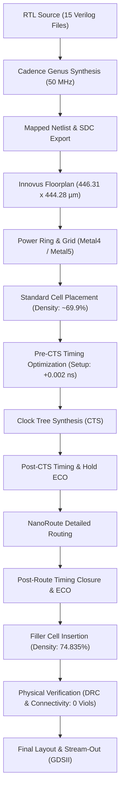
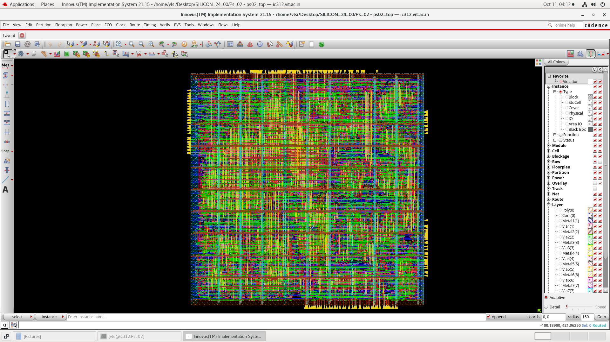
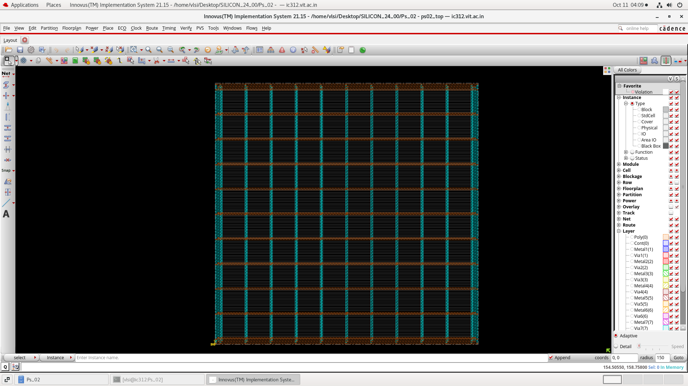
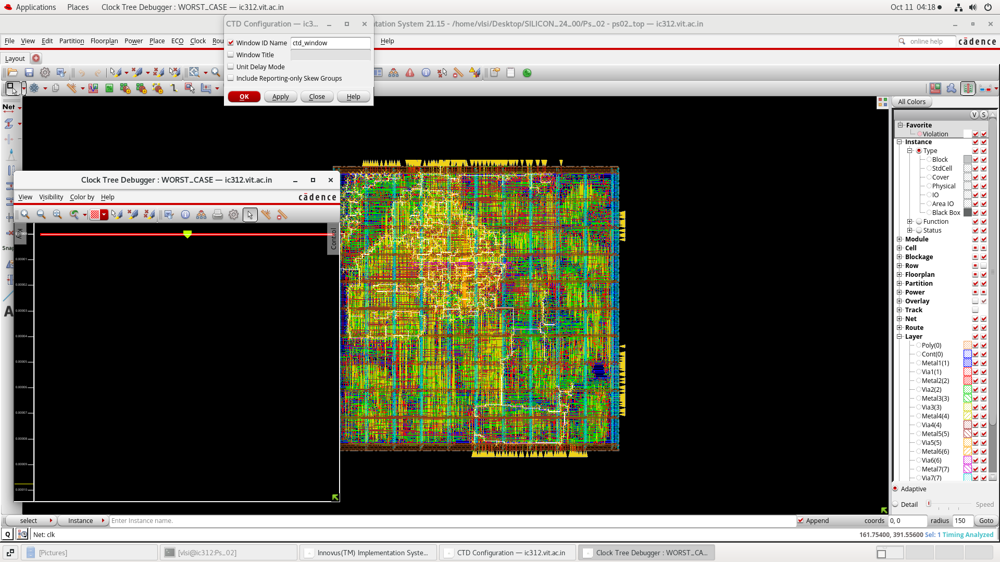
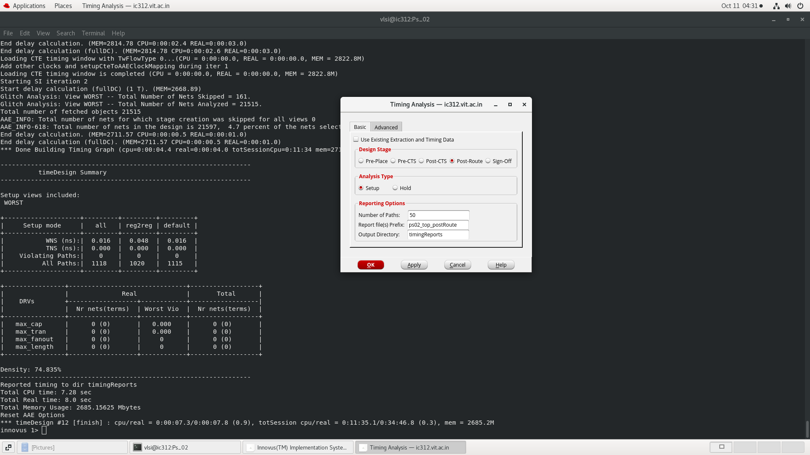
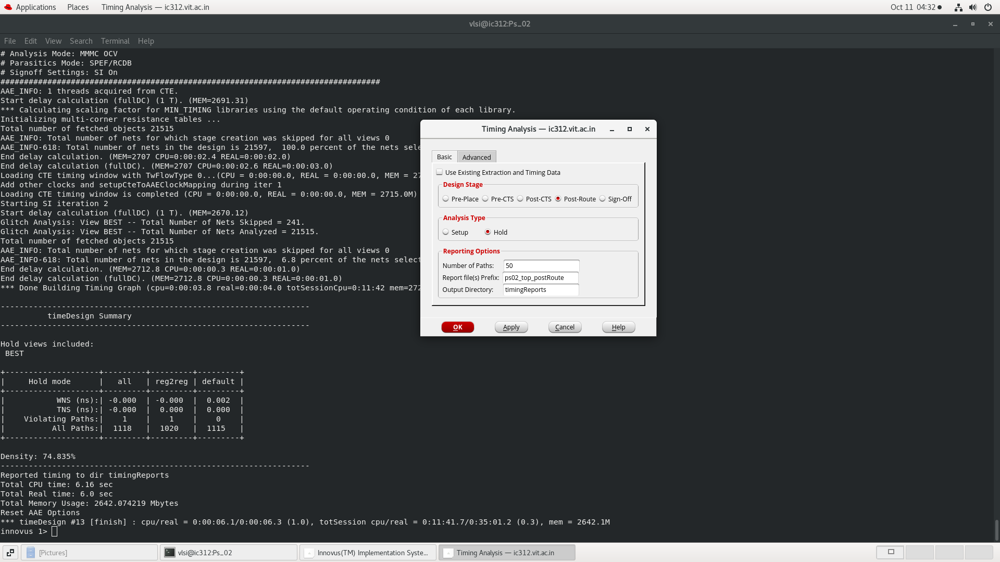
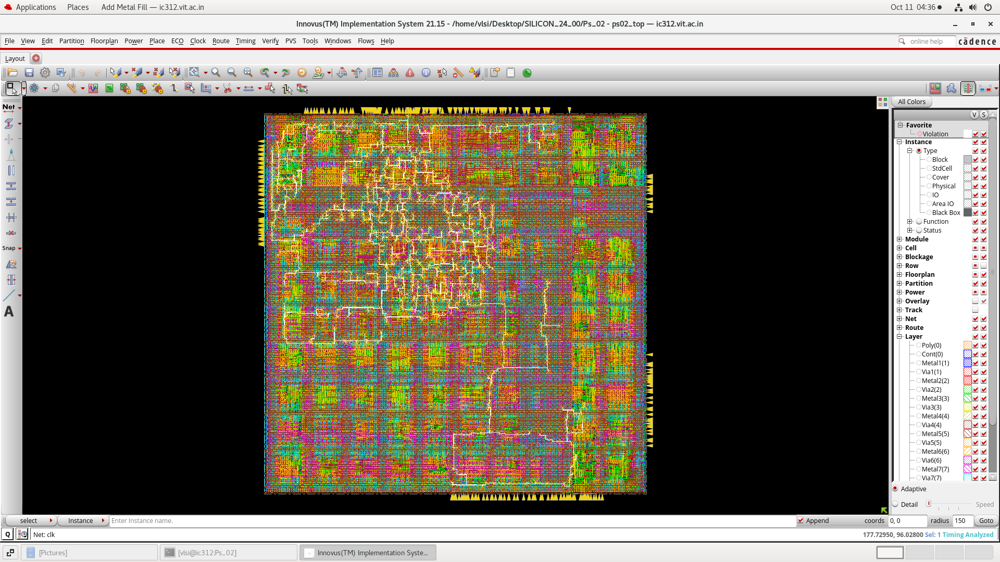
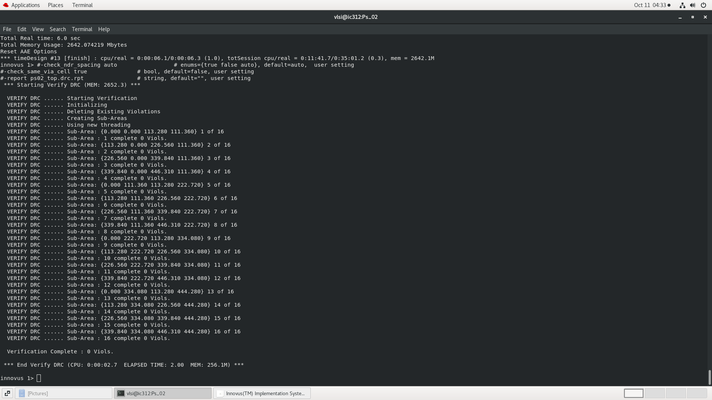
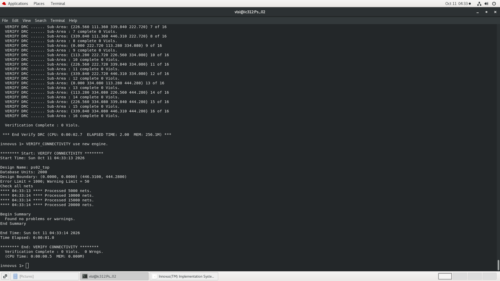

# Physical Design & Implementation Report: PS-02 Mode-Switching PID Controller
**Project:** Silicon Dawn VLSI Hackathon 2026 (PS-02)  
**Authors:** Allen Joe A (24BVD1100), T Venkata Sai Neeraj (24BVD1124)  
**Target ASIC Flow:** Cadence Genus (Synthesis) & Cadence Innovus (Place & Route)  
**Clock Frequency:** 50 MHz (20.0 ns Clock Period)  

---

## 1. Flow Overview & Scope

The physical design flow was executed using **Cadence Innovus Implementation System** following technology mapping in **Cadence Genus Synthesis Solution**. The physical implementation spans from initial die sizing and floorplanning through power mesh synthesis, placement, Clock Tree Synthesis (CTS), NanoRoute detailed routing, post-route timing closure via ECO, core filler cell insertion, and physical DRC/connectivity verification.

---

## 2. Floorplanning and Power Mesh

- **Die Bounding Box:** Bounded from `(0, 0)` to `(446.31, 444.28) µm`, yielding a total footprint of approximately **0.198 mm²**.
- **Power Grid Synthesis:** Symmetrical core power rings in `Metal4` and `Metal5` for `VDD` and `VSS` (4.0 µm width, 2.0 µm spacing) feeding standard cell rail stripes in `Metal1`.
- **Initial Placement:** Standard cells were placed across the core area with initial cell density of approximately **69.9%**.

| Implementation Figure | Description |
|:---:|:---|
|  | Standard cell core distribution after initial placement |
|  | Power rail and grid generation across the core |

---

## 3. Timing Closure Evolution by Stage

Timing closure was tracked across 1,118 timing paths using On-Chip Variation (OCV), Signal Integrity (SI), and SPEF/RCDB extracted parasitics.

### Consolidated Timing Progression

| Implementation Stage | Setup WNS (ns) | Setup Violating Paths | Hold WNS (ns) | Hold Violating Paths | Notes |
|:---|:---:|:---:|:---:|:---:|:---|
| **Pre-CTS (Ideal Clock)** | -7.733 | 220 | -0.180 | 677 | High initial violation before optimization; 158 max_cap nets |
| **Pre-CTS (Post-Opt)** | +0.002 | 0 | -0.186 | 648 | Setup closed under ideal clock; hold deferred to CTS |
| **Post-CTS (Propagated)** | -0.146 | 56 | -0.187 | 668 | Clock network inserted; skew introduced real clock delays |
| **Post-CTS (Post-ECO)** | +0.031 | 0 | -0.010 | 5 | Hold violations dramatically reduced from 668 to 5 |
| **Post-Route (Post-ECO)** | **+0.016** | **0** | **-0.000** | **1** | Setup closed cleanly; hold marginally at 0.000 ns (1 path) |

### Key Observations
1. **Clock Tree Synthesis Impact:** CTS built a balanced clock distribution tree across the core, increasing cell density to 71.590% due to clock buffer insertion.
2. **Post-Route ECO Convergence:** NanoRoute detailed signal routing maintained 0.00% routing congestion across horizontal and vertical routing channels. The subsequent post-route ECO successfully met setup timing with **+0.016 ns slack** across all 1,118 paths.

| Stage Screenshot | Timing Summary |
|:---:|:---|
|  | Clock tree buffer insertion and clock route propagation |
|  | Final Post-Route Setup Timing (WNS: +0.016 ns, 0 Violations) |
|  | Final Post-Route Hold Timing (WNS: -0.000 ns, 1 Marginal Path) |

---

## 4. Final Layout and Physical Verification

Following post-route timing closure, standard core filler cells (`FILL64` through `FILL1`) were inserted to ensure complete N-well continuity, continuous implant layers, and uniform metal density across the core.

- **Final Routed Cell Density:** **74.835%**
- **Design Rule Checking (DRC):** Executed across 16 sub-areas covering the entire 446.31 µm x 444.28 µm boundary.  
  **Result:** `Verification Complete : 0 Viols.`
- **Connectivity Verification:** Executed across all ~20,000 routed signal and power nets.  
  **Result:** `Found no problems or warnings.` (0 violations, 0 warnings).

| Verification Screenshot | Verified Evidence |
|:---:|:---|
|  | Final routed layout with filler cells (446.31 x 444.28 µm) |
|  | Innovus Verify DRC: **0 Violations** |
|  | Innovus Verify Connectivity: **0 Violations, 0 Warnings** |

---

## 5. Summary of Physical Metrics & Implementation Status

| Metric | Measured Value | Verification Source |
|:---|:---:|:---|
| Target Clock Frequency | 50 MHz (20.0 ns period) | `constraints/ps02_top.sdc` |
| Total Die Area | 446.31 µm x 444.28 µm (~0.198 mm²) | Innovus Connectivity Report |
| Post-Route Core Density | 74.835% | Innovus Layout Summary |
| Timing Paths Analyzed | 1,118 Paths | Innovus Timing Reports |
| Total Nets Routed | ~21,600 Nets | Innovus NanoRoute Log |
| Final Setup Slack (WNS) | **+0.016 ns** (0 Violations) | Innovus `timeDesign -postRoute` |
| Final Hold Slack (WNS) | **-0.000 ns** (1 Marginal Path) | Innovus `timeDesign -postRoute -hold` |
| DRC Violations | **0 Violations** | Innovus `verify_drc` |
| Connectivity Violations | **0 Violations, 0 Warnings** | Innovus `verify_connectivity` |
| LVS Status | Innovus connectivity clean; external signoff LVS not run | Technical Report Section 7.6 |
