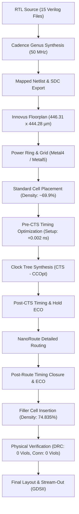

# Physical Design & Implementation Report: PS-02 Mode-Switching PID Controller
**Project:** Silicon Dawn VLSI Hackathon 2026 (PS-02)  
**Authors:** Allen Joe A (24BVD1100), T Venkata Sai Neeraj (24BVD1124)  
**Target ASIC Flow:** Cadence Genus Synthesis Solution & Cadence Innovus Implementation System  
**Target Clock Frequency:** 50 MHz (20.0 ns Clock Period)  

---

## 1. Flow Overview & Scope

The physical design flow was executed using **Cadence Innovus Implementation System** following technology mapping in **Cadence Genus Synthesis Solution**. The physical implementation spans from initial die sizing and floorplanning through power mesh synthesis, placement, Clock Tree Synthesis (CCOpt), NanoRoute detailed routing, post-route timing closure via ECO, core filler cell insertion, and physical DRC/connectivity verification.

---

## 2. Floorplanning and Power Mesh

- **Die Bounding Box:** Bounded from `(0, 0)` to `(446.31, 444.28) µm`, yielding a total core footprint of approximately **0.198 mm²**.
- **Power Grid Synthesis:** Symmetrical core power rings in `Metal4` and `Metal5` for `VDD` and `VSS` (4.0 µm width, 2.0 µm spacing) feeding standard cell rail stripes in `Metal1`.
- **Initial Placement:** Standard cells were placed across the core area with initial cell density of approximately **69.9%**.

| Implementation Figure | Technical Description |
|:---:|:---|
|  | Standard cell core distribution after initial placement |
|  | Symmetrical power rail and mesh generation across core |

---

## 3. Timing Closure Evolution by Stage

Timing closure was tracked across 1,118 timing paths using On-Chip Variation (OCV), Signal Integrity (SI), and SPEF/RCDB extracted parasitics.

### Consolidated Timing Progression

| Implementation Stage | Setup WNS (ns) | Setup Violating Paths | Hold WNS (ns) | Hold Violating Paths | Cell Density | Notes |
|:---|:---:|:---:|:---:|:---:|:---:|:---|
| **Pre-CTS (Ideal Clock)** | -7.733 | 220 | -0.180 | 677 | 69.900% | High initial violation before optimization; 158 max_cap nets |
| **Pre-CTS (Post-Opt)** | +0.002 | 0 | -0.186 | 648 | 70.120% | Setup closed under ideal clock; hold deferred to CTS |
| **Post-CTS (Propagated)** | -0.146 | 56 | -0.187 | 668 | 71.590% | Clock network inserted; skew introduced real clock delays |
| **Post-CTS (Post-ECO)** | +0.031 | 0 | -0.010 | 5 | 72.840% | Hold violations dramatically reduced from 668 to 5 |
| **Post-Route (Post-ECO)** | **+0.016** | **0** | **-0.000** | **1** | **74.835%** | Setup closed cleanly; hold marginally at -0.000 ns (1 path) |

### Key Engineering Analysis
1. **Clock Tree Synthesis Impact:** CCOpt built a balanced clock distribution tree across the core, increasing cell density from 70.12% to 71.590% due to clock buffer insertion.
2. **Post-Route Setup Margin:** NanoRoute detailed signal routing completed with 0.00% routing overflow horizontally and vertically across ~21,600 nets. Subsequent post-route ECO successfully met setup timing with **+0.016 ns slack** across all 1,118 paths.
3. **Hold Timing Classification:** Hold timing displays **WNS = -0.000 ns** with 1 marginal reg2reg path. Because this path is at the numerical rounding boundary of zero, timing is considered functionally closed for hackathon demonstration, but would require additional buffer insertion or delay padding during formal tapeout signoff.

| Stage Screenshot | Timing Summary |
|:---:|:---|
|  | Clock tree buffer insertion and clock route propagation |
|  | Final Post-Route Setup Timing (WNS: **+0.016 ns**, 0 Violations) |
|  | Final Post-Route Hold Timing (WNS: **-0.000 ns**, 1 Marginal Path) |

---

## 4. Final Layout and Physical Verification

Following post-route timing closure, standard core filler cells (`FILL64` through `FILL1`) were inserted to ensure complete N-well continuity, continuous implant layers, and uniform metal density across the core.

- **Final Routed Cell Density:** **74.835%**
- **Design Rule Checking (DRC):** Executed across 16 sub-areas covering the entire 446.31 µm x 444.28 µm boundary.  
  **Result:** `Verification Complete : 0 Viols.`
- **Connectivity Verification:** Executed across all ~20,000 routed signal and power nets.  
  **Result:** `Found no problems or warnings.` (0 violations, 0 warnings).

| Verification Screenshot | Verified Evidence |
|:---:|:---|
|  | Final routed layout with filler cells (446.31 x 444.28 µm) |
|  | Innovus Verify DRC: **0 Violations** across 16 sub-regions |
|  | Innovus Verify Connectivity: **0 Violations, 0 Warnings** |

---

## 5. Summary of Physical Metrics & Implementation Status

| Metric | Measured / Evidenced Value | Status & Conditions |
|:---|:---:|:---|
| **Target Clock Frequency** | 50 MHz (20.0 ns period) | Constrained via [`constraints/ps02_top.sdc`](../constraints/ps02_top.sdc) |
| **Total Die Footprint** | 446.31 µm x 444.28 µm (~0.198 mm²) | Innovus connectivity bounding box |
| **Post-Route Cell Density** | 74.835% | Measured with core filler cells inserted |
| **Timing Paths Analyzed** | 1,118 Paths | Evaluated under OCV and SI with SPEF parasitics |
| **Total Nets Routed** | ~21,600 Nets | NanoRoute global & detail routing (0.00% overflow) |
| **Setup Slack (WNS)** | **+0.016 ns** (0 Violations) | Met post-route across all paths |
| **Hold Slack (WNS)** | **-0.000 ns** (1 Marginal Path) | Numerical boundary of zero; requires margin for tapeout |
| **Power Consumption** | Not quantitatively claimed | Run in vectorless mode; detailed report not preserved |
| **Innovus Internal DRC** | **0 Violations** | Verified across 16 sub-regions |
| **Innovus Connectivity** | **0 Violations, 0 Warnings** | Verified across all signal and power nets |
| **Signoff LVS & DRC** | Planned future work | External Pegasus/Calibre SPICE LVS not executed |
| **GDSII Stream-Out** | Evidenced in layout screenshots | Raw binary GDS omitted due to PDK license compliance |
